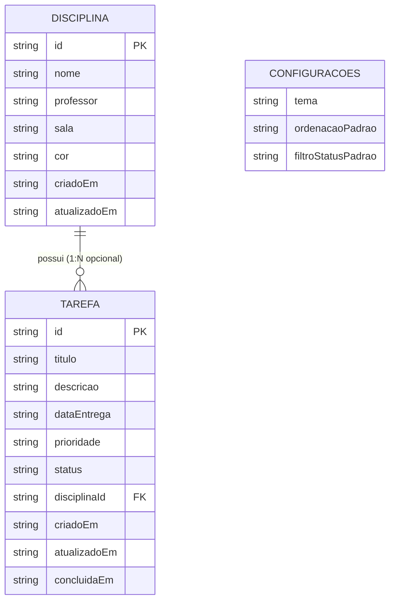

# Data Model: AgendaIFES MVP

**Feature**: `001-academic-agenda`  
**Date**: 2026-10-31  
**Status**: Completed  

---

## 1. Overview & Storage Topology

O AgendaIFES é uma aplicação **local-first** que opera sem banco de dados remoto ou servidores. Todos os dados são armazenados no `localStorage` do navegador sob uma chave com namespace e versionamento (`agenda_ifes_v1_store`), além de serem serializados e desserializados no formato JSON para portabilidade.

```
+-------------------------------------------------------------+
|                      localStorage                           |
|  Key: agenda_ifes_v1_store                                  |
|  +-------------------------------------------------------+  |
|  | {                                                     |  |
|  |   "versao": 1,                                        |  |
|  |   "disciplinas": [ ... ],                             |  |
|  |   "tarefas": [ ... ],                                 |  |
|  |   "configuracoes": { ... }                            |  |
|  | }                                                     |  |
|  +-------------------------------------------------------+  |
+-------------------------------------------------------------+
```

---

## 2. Core Entities

### 2.1 Disciplina (Course/Subject)

Representa uma unidade curricular cursada pelo estudante no IFES Campus Serra.

| Campo | Tipo | Obrigatório | Descrição / Restrições |
| :--- | :--- | :--- | :--- |
| `id` | `string` | Sim | Identificador único (UUID v4 ou nanoid). |
| `nome` | `string` | Sim | Nome da disciplina (2 a 100 caracteres). Único entre disciplinas ativas. |
| `professor` | `string` | Não | Nome do docente responsável (máx. 100 caracteres). |
| `sala` | `string` | Não | Local das aulas ou laboratório (máx. 50 caracteres, ex: "Lab 3", "Sala 102"). |
| `cor` | `string` | Sim | Código de cor hexadecimal (ex: `#006633` verde IFES, `#1E40AF` azul). |
| `criadoEm` | `string` | Sim | Data e hora de criação em formato ISO 8601 (`YYYY-MM-DDTHH:mm:ss.sssZ`). |
| `atualizadoEm` | `string` | Sim | Data e hora da última modificação em formato ISO 8601. |

### 2.2 Tarefa (Academic Task/Assignment)

Representa um trabalho, prova, lista de exercícios, relatório ou compromisso acadêmico com prazo.

| Campo | Tipo | Obrigatório | Descrição / Restrições |
| :--- | :--- | :--- | :--- |
| `id` | `string` | Sim | Identificador único (UUID v4 ou nanoid). |
| `titulo` | `string` | Sim | Título da atividade (3 a 150 caracteres). |
| `descricao` | `string` | Não | Detalhes, observações ou orientações da entrega (máx. 1.000 caracteres). |
| `dataEntrega` | `string` | Sim | Data e horário limite de entrega em formato ISO 8601 (`YYYY-MM-DDTHH:mm`). |
| `prioridade` | `enum` | Sim | `'BAIXA'` \| `'MEDIA'` \| `'ALTA'` (Padrão: `'MEDIA'`). |
| `status` | `enum` | Sim | `'PENDENTE'` \| `'CONCLUIDA'` (Padrão: `'PENDENTE'`). |
| `disciplinaId` | `string \| null` | Não | Identificador da `Disciplina` associada, ou `null` se não vinculada. |
| `criadoEm` | `string` | Sim | Data e hora de criação em formato ISO 8601. |
| `atualizadoEm` | `string` | Sim | Data e hora da última alteração em formato ISO 8601. |
| `concluidaEm` | `string \| null` | Não | Data e hora em que a tarefa foi concluída, ou `null` se pendente. |

### 2.3 ConfiguracoesUsuario (User Preferences)

Configurações e preferências de exibição do estudante salvas localmente.

| Campo | Tipo | Padrão | Descrição |
| :--- | :--- | :--- | :--- |
| `tema` | `'claro' \| 'escuro' \| 'sistema'` | `'sistema'` | Preferência de tema visual da interface. |
| `ordenacaoPadrao` | `'prazo' \| 'prioridade' \| 'titulo'` | `'prazo'` | Critério padrão de listagem na inicialização. |
| `filtroStatusPadrao`| `'todos' \| 'pendentes' \| 'concluidas'` | `'pendentes'` | Visualização inicial da listagem de tarefas. |

### 2.4 PacoteBackup (JSON Backup Package)

Estrutura formal utilizada para importação e exportação de backups do sistema.

| Campo | Tipo | Obrigatório | Descrição |
| :--- | :--- | :--- | :--- |
| `versaoSchema` | `number` | Sim | Versão do esquema de dados. Valor fixo: `1`. |
| `origem` | `string` | Sim | Identificador da aplicação. Valor fixo: `"AgendaIFES"`. |
| `geradoEm` | `string` | Sim | Data e hora da exportação em formato ISO 8601. |
| `dados` | `object` | Sim | Contém os arrays de `disciplinas`, `tarefas` e objeto de `configuracoes`. |

---

## 3. Computed / Derived Domain Attributes (Runtime)

Estes atributos não são persistidos no armazenamento para evitar redundância, sendo calculados em tempo de execução via funções puras de domínio:

- **`statusVencimento`** da Tarefa:
  - `VENCIDA`: Tarefa com `status === 'PENDENTE'` e `dataEntrega < dataHoraAtual`.
  - `URGENTE`: Tarefa com `status === 'PENDENTE'` e `dataHoraAtual <= dataEntrega <= dataHoraAtual + 24 horas`.
  - `NO_PRAZO`: Tarefa com `dataEntrega > dataHoraAtual + 24 horas` ou com `status === 'CONCLUIDA'`.
- **`tempoRestanteFormatado`**: Formatação amigável do prazo (ex.: *"Vence hoje às 23:59"*, *"Atrasada há 2 dias"*, *"Vence em 3 dias"*).

---

## 4. Entity Relationships & Integrity Rules



1. **Exclusão de Disciplina (Desassociação Suave)**:
   - Quando uma `Disciplina` é excluída pelo estudante, o sistema **não** exclui as tarefas vinculadas.
   - O sistema atualiza todas as tarefas com `disciplinaId === idExcluido` definindo `disciplinaId = null`.
2. **Unicidade de Disciplina**:
   - Não é permitido cadastrar duas disciplinas ativas com o mesmo nome (comparação insensível a maiúsculas/minúsculas após remoção de espaços em branco).
3. **Imutabilidade de IDs**:
   - Uma vez gerado na criação, o `id` da entidade nunca se altera, preservando a rastreabilidade em backups e referências cruzadas.

---

## 5. Zod Runtime Validation Schemas (Specification)

```typescript
import { z } from 'zod';

export const PrioridadeSchema = z.enum(['BAIXA', 'MEDIA', 'ALTA']);
export const StatusTarefaSchema = z.enum(['PENDENTE', 'CONCLUIDA']);

export const DisciplinaSchema = z.object({
  id: z.string().min(1, 'ID obrigatório'),
  nome: z.string().trim().min(2, 'Nome deve ter no mínimo 2 caracteres').max(100, 'Nome muito longo'),
  professor: z.string().trim().max(100).optional().default(''),
  sala: z.string().trim().max(50).optional().default(''),
  cor: z.string().regex(/^#([0-9A-Fa-f]{6})$/, 'Cor inválida (deve ser hex #RRGGBB)'),
  criadoEm: z.string().datetime(),
  atualizadoEm: z.string().datetime(),
});

export const TarefaSchema = z.object({
  id: z.string().min(1, 'ID obrigatório'),
  titulo: z.string().trim().min(3, 'Título deve ter no mínimo 3 caracteres').max(150, 'Título muito longo'),
  descricao: z.string().trim().max(1000).optional().default(''),
  dataEntrega: z.string().min(10, 'Data de entrega inválida'),
  prioridade: PrioridadeSchema.default('MEDIA'),
  status: StatusTarefaSchema.default('PENDENTE'),
  disciplinaId: z.string().nullable().default(null),
  criadoEm: z.string().datetime(),
  atualizadoEm: z.string().datetime(),
  concluidaEm: z.string().datetime().nullable().default(null),
});

export const ConfiguracoesSchema = z.object({
  tema: z.enum(['claro', 'escuro', 'sistema']).default('sistema'),
  ordenacaoPadrao: z.enum(['prazo', 'prioridade', 'titulo']).default('prazo'),
  filtroStatusPadrao: z.enum(['todos', 'pendentes', 'concluidas']).default('pendentes'),
});

export const PacoteBackupSchema = z.object({
  versaoSchema: z.literal(1),
  origem: z.literal('AgendaIFES'),
  geradoEm: z.string().datetime(),
  dados: z.object({
    disciplinas: z.array(DisciplinaSchema),
    tarefas: z.array(TarefaSchema),
    configuracoes: ConfiguracoesSchema.optional(),
  }),
});
```
